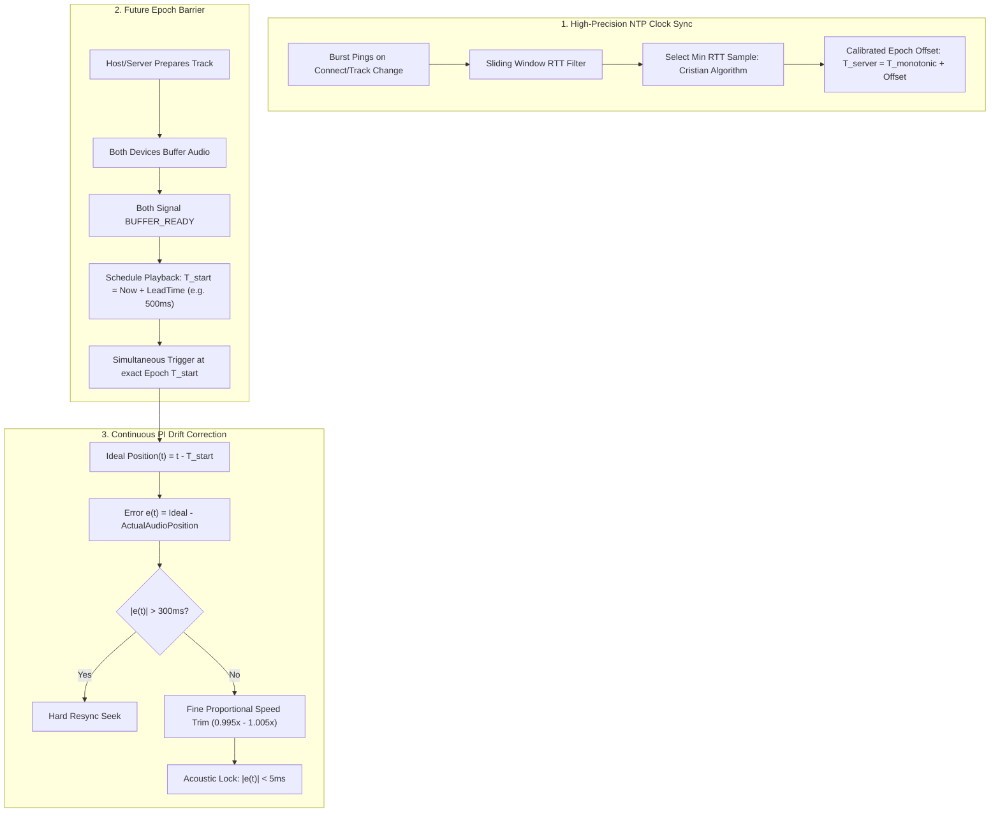

# High-Precision Audio Synchronization for Listen Together

## 1. Executive Summary & Problem Analysis

### 1.1 The Goal: Multi-Phone Acoustic Amplification
When multiple phones in the same physical space play the same audio stream, human psychoacoustics dictate the perceived result based on timing alignment:
* **$\Delta t < 5\text{ ms}$ (Phase-Summation / Acoustic Reinforcement):** Sound waves constructively interfere and sum together. The human ear perceives a single, noticeably louder, fuller sound source.
* **$5\text{ ms} < \Delta t < 30\text{ ms}$ (Haas / Precedence Effect & Comb Filtering):** The listener hears localized sound with severe flanging, hollow comb filtering, or chorus artifacts.
* **$\Delta t > 30\text{ ms} - 50\text{ ms}$ (Echo & Disjointed Playback):** The sound breaks apart into a distinct, chaotic echo.

### 1.2 Root Cause Analysis of Current Implementation
Inspection of [`ServerClock.kt`](file:///dev/shm/Metrolist/app/src/main/kotlin/com/metrolist/music/listentogether/ServerClock.kt), [`ListenTogetherClient.kt`](file:///dev/shm/Metrolist/app/src/main/kotlin/com/metrolist/music/listentogether/ListenTogetherClient.kt), and [`ListenTogetherManager.kt`](file:///dev/shm/Metrolist/app/src/main/kotlin/com/metrolist/music/listentogether/ListenTogetherManager.kt) revealed why current Listen Together sessions suffer from audible desynchronization:

1. **Unsynchronized Track Start:**
   * When the host selects a song, playback starts immediately on the host.
   * The guest receives `CHANGE_TRACK` and starts resolving, connecting, and buffering via ExoPlayer (500 ms – 2000 ms variable delay).
   * By the time the guest starts playing, the host is already several seconds in.
2. **Coarse Drift Deadbands & Thresholds:**
   * In [`ListenTogetherManager.kt`](file:///dev/shm/Metrolist/app/src/main/kotlin/com/metrolist/music/listentogether/ListenTogetherManager.kt#L84-L88):
     * `SOFT_SYNC_THRESHOLD_MS = 50L`: If drift is $\le 50\text{ ms}$, drift correction stops completely. $50\text{ ms}$ is $10\times$ too loose for acoustic summation.
     * `ACTIVE_PLAYBACK_SYNC_TOLERANCE_MS = 2_000L`: Heartbeat playback updates ignore position differences up to $2.0\text{ s}$.
     * `DRIFT_CORRECTION_SPEED = 0.02f` ($\pm 2\%$): Abruptly toggles speed between $1.0\times$ and $1.02\times$ without smooth proportional scaling.
3. **Slow & Jitter-Prone Clock Sampling:**
   * `ServerClock` receives pings once every $25\text{ seconds}$ (`PING_INTERVAL_MS = 25000L`).
   * A single moving average weight ($0.25$ / $0.05$) is applied without minimum-RTT filtering or sliding window outlier rejection, causing network latency spikes to distort the clock offset.
4. **Neglected Hardware Audio Latency:**
   * Different Android devices have different AudioTrack buffer depths and hardware DAC latencies (ranging from $20\text{ ms}$ to $120\text{ ms}$, or higher over Bluetooth). Without hardware compensation or manual micro-trimming, even a perfect server clock will output audio out of phase.

---

## 2. Precision Architecture

### 2.1 Refined NTP-Style Clock Filter (`ServerClock`)
Under RFC 5905 (Network Time Protocol), the clock offset $\theta$ and round-trip delay $\delta$ are computed from four timestamps:
$$\theta = \frac{(T_{\text{server\_recv}} - T_{\text{client\_send}}) + (T_{\text{server\_send}} - T_{\text{client\_recv}})}{2}$$
$$\delta = (T_{\text{client\_recv}} - T_{\text{client\_send}}) - (T_{\text{server\_send}} - T_{\text{server\_recv}})$$

* **Min-RTT Selection:** Network queuing jitter is strictly additive. The sample with the minimum round-trip time $\delta_{\min}$ within a sliding window of the last 8–12 samples represents the most symmetric network path and gives the most accurate clock offset estimate.
* **Burst Pinging:** Send a burst of 5 pings (100 ms apart) upon room entry, reconnection, or track transition to lock the clock offset within $0.5\text{ s}$, then sustain with periodic pings every $5\text{ s}$.

### 2.2 Scheduled Epoch Playback Start
Instead of starting immediately:
1. When host selects a track or resumes: Both host and guest enter buffering state.
2. Once buffered, host/server emits a start barrier:
   $$\text{PlayAt}(\text{epochTimestamp} = T_{\text{now}} + \Delta_{\text{lead}}, \text{startPosition} = 0)$$
3. ExoPlayer is primed (buffered, paused, ready to render).
4. Both phones start audio rendering simultaneously when $T_{\text{server}} \ge \text{epochTimestamp}$.

### 2.3 Proportional Drift Correction
Replace the coarse $50\text{ ms}$ threshold with a continuous proportional trim:
* **Deadband:** $\pm 3\text{ ms}$ (considered in perfect lock, speed = $1.000\times$).
* **Subtle Trim ($3\text{ ms} < |\text{drift}| \le 200\text{ ms}$):**
  $$\text{speed} = 1.0 + \text{clamp}(K_p \cdot \text{drift}, -0.01, +0.01)$$
  A $1\%$ speed adjustment corrects a $10\text{ ms}$ error in exactly $1\text{ second}$, completely undetectable in pitch by human hearing.
* **Hard Seek ($|\text{drift}| > 200\text{ ms}$):** Re-seek directly to target position.

### 2.4 Device Audio Latency Offset Calibration
* Provide a **Sync Offset Calibration** setting in Listen Together Settings:
  * Range: $-150\text{ ms}$ to $+150\text{ ms}$ (step $1\text{ ms}$).
  * Allows users to dial in exact acoustic alignment for their specific phone speaker / hardware combination.

---

## 3. Implementation Roadmap

| Phase | Scope | Components |
|---|---|---|
| **Phase 1: Clock Accuracy** | Enhance `ServerClock.kt` with sliding window min-RTT filter, burst pinging, and nanosecond monotonic timebase. | `ServerClock.kt`, `ListenTogetherClient.kt` |
| **Phase 2: Drift Controller** | Replace coarse thresholds in `ListenTogetherManager.kt` with continuous proportional speed trim and tight lock target (<5ms). | `ListenTogetherManager.kt` |
| **Phase 3: Synchronized Start** | Implement scheduled future-epoch playback barrier using `BufferComplete` / `captured_at_server_time`. | `ListenTogetherManager.kt`, `ListenTogetherClient.kt` |
| **Phase 4: Latency Calibration UI** | Add fine-grained sync calibration slider (ms) in Listen Together settings. | `ListenTogetherSettings.kt`, `metrolist_strings.xml` |

